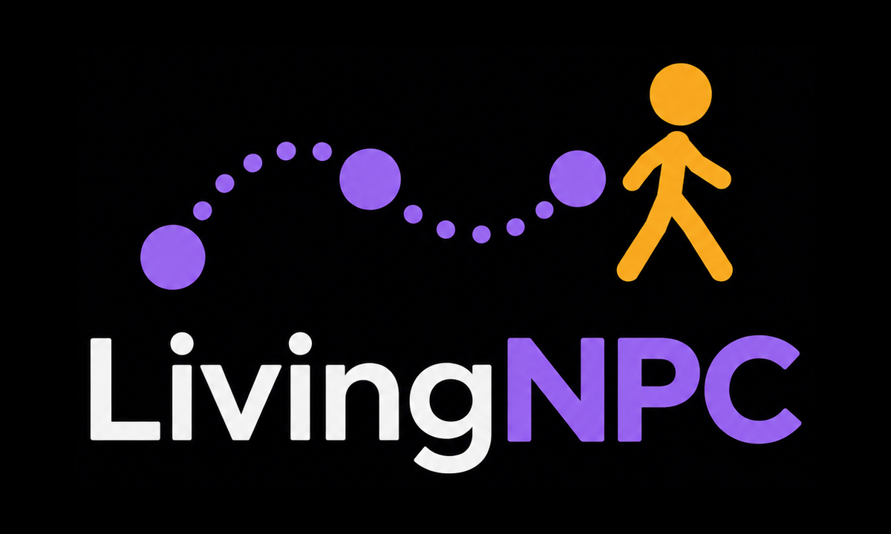

<p align="center">
  
</p>

<p align="center"><b>A visual novel engine where every NPC lives their own life.</b></p>

> ⚠️ **Alpha – version 0.1.1-alpha.** LivingNPC works and is fun to build with, but it is young: expect rough edges,
> missing features and changes to the file formats between versions. Feedback, bug reports and contributions are very
> welcome.

In most visual novels the characters wait for the player. In LivingNPC they don't. The teacher gives her lessons in
the morning and goes home at night, the student sleeps late on Sundays, the innkeeper opens the tavern at six –
whether the player is there or not. Every character follows their own routine, with their own places, stats and
inventory, and the story reacts to **who is where, when, and what has happened so far**.

You write the world as plain files – places, characters, routines, quests and dialogues – with two visual editors and
a small Python-like script language. Because everything is simple, well-documented JSON, an **AI assistant can help
you write it**: describe a character or a quest, and let it draft the files for you to review.

## Features

- **Living characters.** Weekly routines with priorities, named places (`home`, `work`, `$school`…), activities that
  change their stats over time. Characters plan their trips and leave early to arrive on time, also off screen.
- **A world that keeps going.** Time moves when the player travels, waits or sleeps; everyone else moves with it.
  Places change background with the time of day.
- **Characters with a will of their own.** First name, last name, age, sex, a goal and relations with the others;
  with *automatic quests* on they pick by themselves quests written as templates ("bring bread to a friend", "study in
  the library"), weighted by their goal, stats and relations, and do them off screen too.
- **Quests and messages that react to the world.** Start a quest only *in that place, at that hour, with those
  characters*; wait two days; fail it if the player is late. Dialogues with lines, poses, choices, `if` / `else`,
  pictures, sounds and music.
- **Change the world from the story.** Move a character's job, give them a new routine, open or hide a path, give and
  take items, change stats and flags.
- **Two editors.** A **map editor** to draw places and links, and **LivingNPC Studio** to write quests and dialogues
  as code and edit characters, items, rules and the title screen with forms – with live error checking.
- **Data, not code.** Worlds are folders of JSON and pictures: easy to version, to mod (packs can patch each other)
  and to generate with AI. **F5** reloads everything without losing the game in progress.
- **Saves** with screenshots, autosave every new day, quick save / load.
- **Built on Unity DOTS** (Entities + Burst) for the simulation, with the UI kept separate.

## What's in this repository

| Folder | What it is |
|---|---|
| [`unity/LivingNPC`](unity/LivingNPC) | The game engine (Unity 6). Opens the worlds in `worlds/` and plays them. |
| [`studio`](studio) | **LivingNPC Studio**: quests and messages as code, plus characters, items, rules and title screen. |
| [`map-editor`](map-editor) | **LivingNPC Map Editor**: places, backgrounds and the links between them. |
| [`worlds`](worlds) | The worlds. [`aetherhall`](worlds/aetherhall) is a small example: a school of magic. |
| [`docs`](docs) | Documentation: Studio commands, JSON reference, architecture. |

## Requirements

- **Unity 6000.3.19f1** (Unity 6.3) – install it from Unity Hub.
- **Node.js 20** or newer, for the editors.
- Windows is the tested platform. The editors run anywhere Node.js does (the `start.bat` files are Windows shortcuts
  for the commands in their READMEs).

## Quick start

**Play the example world**

1. Clone or download this repository.
2. In **Unity Hub**, choose *Add project from disk* and select `unity/LivingNPC`. Open it (the first import takes a
   few minutes).
3. Press **Play**. The game starts on its own, in any scene, and opens the first world in `worlds/` – Aetherhall.
   To pick another world use the menu **LivingNPC ▸ Choose World…**.

Controls: click the buttons on the picture to move; click a character (or the *Present* list) to talk;
**Space / Enter** to continue a dialogue; **Esc** game menu (save, load, settings); **F6** quick save, **F9** quick
load; **F5** reload all files keeping the game; **F12** debug panel (where every character is, quests, events, flags,
and a console that runs the quest commands, e.g. `setStat(energy, 80, target=elena)`).

**Open the editors**

- **LivingNPC Studio:** double-click `studio/start.bat`, or run `node server.mjs` in `studio/`. It opens
  http://127.0.0.1:5180.
- **Map Editor:** double-click `map-editor/start.bat`, or run `npm install`, `npm run build` and `npm start` in
  `map-editor/`. It opens http://localhost:5173.

Both editors read and write the folders in `worlds/` directly: save in an editor, press **F5** in the game, and see the
change.

**Without installing Node.js (Windows):** download the `LivingNPC-Editors-…-win-x64.zip` package from the Releases
page, or build it yourself with `powershell -ExecutionPolicy Bypass -File tools\build-editors.ps1`. It contains
**LivingNPC Studio.exe** and **LivingNPC Map Editor.exe** with Node.js included: double-click one, and close its
console window to stop it. Put the folder inside the repository (or next to a `worlds` folder) and the editors find
your worlds by themselves.

## Making your own world

1. **Create the world folder:** `worlds/<your_world>/base/pack.json` with
   `{ "id": "base", "name": "Your world" }`. (Or copy `worlds/aetherhall` and change it.)
2. **Draw the places** in the Map Editor: *Load World* → your world, add places, upload their backgrounds, connect
   them with links, choose the start place, *Save World*.
3. **Set the rules** in Studio, tab *Rules*: start time, stats, activities, parts of the day, sleep.
4. **Add the characters** in Studio, tab *Characters*: their places, their weekly routine (with a chart of where they
   are each hour), stats, inventory and pictures.
5. **Write quests and messages** in Studio as code:

   ```python
   event ev_elena_lesson:
       trigger = talk
       npc = elena
       when:
           activity(elena, work)

       elena: "Hi! I'm in the middle of a lesson."
       choice:
           option "Sorry, I'll come back later":
               pass
           option "Can I join?":
               elena [happy]: "Of course, take a seat."
               advanceTime(60)
               modStat(happiness, 5)
   ```

6. **Press Play** in Unity (or F5 if it is already running) and try it.

**Build the game:** *File ▸ Build Profiles* in Unity, then put your world next to the executable, in a folder called
`World` (`World/base/…`). The game opens it directly on start.

## Working with an AI assistant

LivingNPC was designed to be written together with AI tools:

- give the assistant [`docs/JSON_REFERENCE.md`](docs/JSON_REFERENCE.md) as its instructions, plus your world's
  `lore/*.md` notes and the files it should change;
- ask it for new characters, routines, quests or dialogues **as JSON files** (or as Studio script);
- open them in Studio: errors and unknown ids are shown immediately;
- load them in the game (F5) and check `content_report.txt`, which lists every problem with file and id – you can
  hand it back to the assistant to fix.

## Documentation

- [Studio script language](docs/STUDIO_COMMANDS.md) – every command and condition of LivingNPC Studio.
- [JSON reference](docs/JSON_REFERENCE.md) – every file of a world and every field.
- [Architecture](docs/ARCHITECTURE.md) – how the engine works and how to extend it.
- [LivingNPC Studio](studio/README.md) and [Map Editor](map-editor/README.md) – the editors.
- [Smoke tests](unity/LivingNPC/SmokeFixtures/README.md) – the headless game tests.

## Known limitations (alpha)

- Tested on Windows only. Android and WebGL are not supported yet.
- Items have no icons or "use" action yet; there are no shops.
- Ids cannot be renamed from the editors' forms yet (quests and messages that use them would need updating).
- Saves are not compatible across versions of the save format, and the world format may still change.
- The interface of the game is English-only; world texts can be in any language (`rules.json` → `language`).

## Contributing

Bug reports, ideas and pull requests are welcome – open an issue to discuss bigger changes first. When you add a
condition or an effect to the engine, add it to `studio/lib/specs.js` and to the docs too, so the editors and the
reference stay in step. Run the tests before sending a change:

```bash
cd studio && npm test
cd map-editor && npm test
```

and the Unity smoke tests described in [SmokeFixtures](unity/LivingNPC/SmokeFixtures/README.md).

## License

LivingNPC is released under the **[Mozilla Public License 2.0](LICENSE)**. In short:

- you can use it, also commercially, and **modify it to add the features you need**;
- if you distribute a modified version of LivingNPC's own files, those files must stay open source under the MPL;
- **your games, your worlds and the new files you write remain yours**, under the license you choose – you can sell
  your game.

The example world's pictures, music and sounds have their own credits and terms: see
[`worlds/aetherhall/CREDITS.md`](worlds/aetherhall/CREDITS.md).
